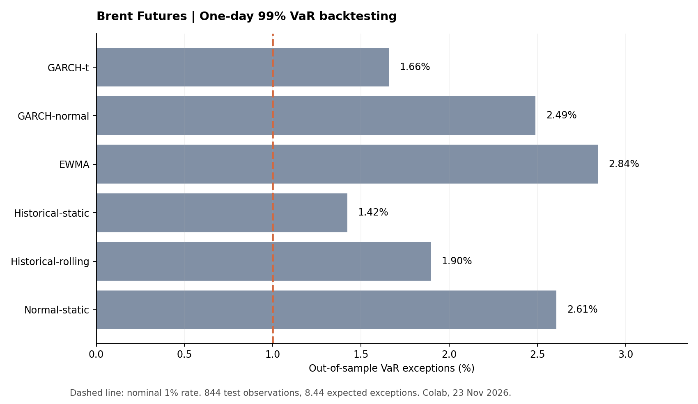
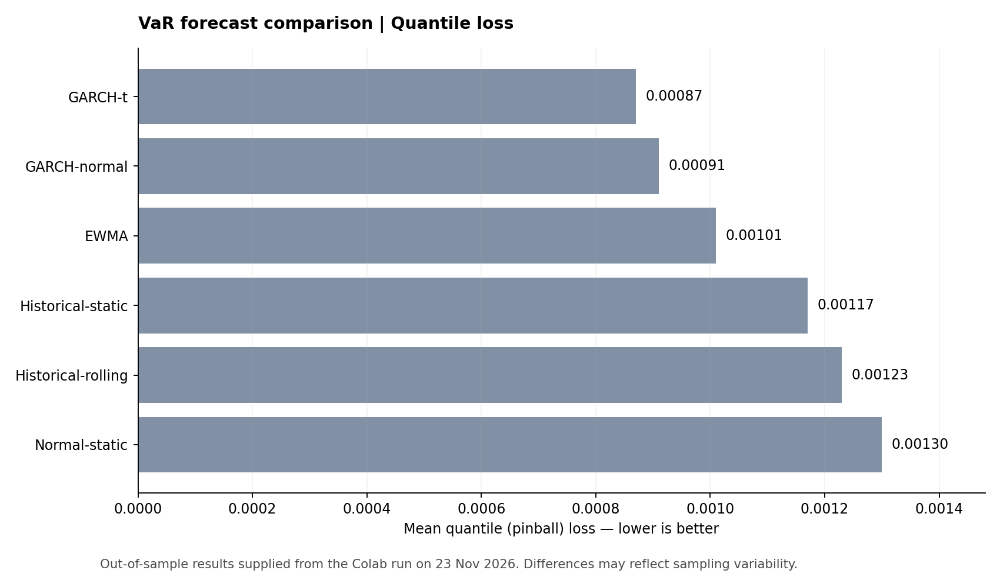

# Brent Market Risk: ARMA, GARCH and Value at Risk

**A reproducible Python study of one-day, 99% Value at Risk (VaR) for Brent crude oil futures.**

This project examines daily log returns of the Yahoo Finance `BZ=F` continuous Brent futures series, tests their time-series properties, estimates ARMA and GARCH models, and compares **six** VaR forecasting approaches using a chronological out-of-sample backtest.

> **Main research question:** Does accounting for heavy tails and time-varying volatility produce better calibrated tail-risk forecasts than conventional Gaussian methods?



*Exception rates for six methods, 844 test observations. The 1% nominal exception probability is shown by the dashed line.*



**Headline result:** Student-t GARCH(1,1) achieved the lowest quantile loss (0.00087) and was not rejected by the Kupiec or conditional coverage test at the 5% level. Static historical simulation had the lowest exception rate (1.42%) but a higher quantile loss (0.00117). These are empirical outcomes of **one held-out period**, not proof of universal model superiority.

## Models

| Model | Tail assumption | Volatility / data window |
| --- | --- | --- |
| Gaussian static VaR | Normal | Full training-sample mean and variance |
| EWMA (RiskMetrics style) | Normal | Recursive variance, decay factor λ = 0.94 |
| GARCH(1,1), Gaussian | Normal | One-step-ahead conditional volatility |
| GARCH(1,1), Student-t | Standardized Student-t | One-step-ahead conditional volatility; estimated degrees of freedom |
| Historical simulation, static | Empirical | Full training-sample 1% quantile |
| Historical simulation, rolling | Empirical | Past 1,000 daily returns only |

Both GARCH models use a **constant conditional mean** and are fitted separately from the ARMA exercise. The ARMA analysis serves as a diagnostic of serial dependence in returns, not as a joint ARMA-GARCH mean specification.

## Methodology

1. **Market data.** `BZ=F`, downloaded via `yfinance`. Daily sample starts on 2010-01-01 and is capped at the **last included session, 2026-11-20** (`end='2026-11-21'` is exclusive). Only completed historical sessions are included. A continuous futures series can contain contract-roll effects and should not be confused with the Brent spot price or a fully executable investment strategy.
2. **Returns.** Daily log returns `ln(P_t / P_{t-1})`, cleaned and date-sorted.
3. **Train/test split.** First **80%** of returns for estimation; last **20%** held out chronologically. No shuffling.
4. **Diagnostics.** ADF unit-root tests, Ljung-Box tests on returns and squared returns, ARCH-LM and Jarque-Bera. ARMA(p,q) grid search for p,q = 0,...,3, with converged models ranked by AIC.
5. **Conditional volatility.** Constant-mean GARCH(1,1) estimated under Gaussian and standardized Student-t innovations. Diagnostics on standardized residuals assess remaining autocorrelation, ARCH effects and normality.
6. **VaR estimation.** Six one-day lower-tail **1% return quantile** forecasts. Every forecast uses only information available **before** its corresponding realized return. For dynamic EWMA, GARCH and historical rolling methods, the model parameters are estimated on training data and the forecasts are sequentially updated using past realized returns.
7. **Backtesting.** Exception rate, Kupiec unconditional coverage test, Christoffersen first-order exception independence test, conditional coverage test (combined LR) and quantile/pinball loss.

We report **negative return thresholds** `q_(0.01,t)` rather than the positive VaR loss magnitude common in some financial reporting.

### Key formulas

**GARCH(1,1)**

\[
h_t=\omega+\alpha\varepsilon_{t-1}^{2}+\beta h_{t-1}
\]

**Gaussian VaR lower-tail quantile**

\[
q_{0.01,t}=\mu_t+\Phi^{-1}(0.01)\sqrt{h_t}
\]

**RiskMetrics-style EWMA** (demeaned-return variant)

\[
h_t=0.94h_{t-1}+0.06(r_{t-1}-\bar r_{\mathrm{train}})^2
\]

**Historical simulation**

\[
q_{0.01,t}^{HS}=\operatorname{quantile}_{0.01}(r_{t-n},\dots,r_{t-1})
\]

**Student-t GARCH:** standardized Student-t quantiles are variance-normalized using `sqrt((ν−2)/ν)` so that the scale matches the fitted conditional standard deviation.

## Out-of-sample results: 23 November 2026 Colab run

The analysis uses **4,216 daily log returns**, with **3,372 training** and **844 test** observations. At a one-day 99% VaR level, expected exceptions are **8.44**. Values below were transcribed from the user's actual Colab run of the revised six-model notebook (rounded as displayed); this repository has not independently re-downloaded the market data in a separate environment.

| Model | Exceptions | Rate (%) | Kupiec p | Independence p | Conditional coverage p | Mean threshold (%) | Quantile loss |
| --- | ---: | ---: | ---: | ---: | ---: | ---: | ---: |
| **GARCH-t** | **14** | **1.659** | **0.07891** | **0.22524** | **0.10240** | −5.877 | **0.00087** |
| GARCH-normal | 21 | 2.488 | 0.00026 | 0.54587 | 0.00105 | −5.258 | 0.00091 |
| EWMA | 24 | 2.844 | 0.00001 | 0.71125 | 0.00006 | −5.161 | 0.00101 |
| Historical-static | 12 | 1.422 | 0.24679 | 0.55605 | 0.43000 | −6.677 | 0.00117 |
| Historical-rolling | 16 | 1.896 | 0.01995 | 0.30453 | 0.03936 | −6.817 | 0.00123 |
| Normal-static | 22 | 2.607 | 0.00009 | 0.01748 | 0.00003 | −5.400 | 0.00130 |

**Interpretation:**

- **GARCH-t** recorded the lowest quantile loss of the six methods. Its Kupiec p-value (0.07891) and combined conditional coverage p-value (0.10240) do not reject coverage at **5%**; the Kupiec result is borderline and *would* be rejected at 10%.
- **Historical-static** came closest to the 1% exception rate, and its coverage tests were not rejected at 5%. However, it had a more negative average threshold (−6.68%) and a higher quantile loss than GARCH-t. Fewer exceptions alone do not imply better forecasting.
- **Gaussian approaches** (normal-static, normal GARCH and EWMA) exceeded the nominal 1% failure rate and failed the Kupiec test. This is consistent with the earlier diagnostics showing heavy tails, but does not establish causation.
- **Historical-rolling** failed the unconditional and combined conditional coverage tests at 5%.
- The independence test does **not** reject clustering for GARCH-t (p = 0.22524). With only 14 exceptions, however, the test may have limited power.

These results suggest that modelling conditional volatility **and** heavy tails can improve tail-risk forecasts on this sample. The GARCH-t versus normal GARCH quantile-loss difference is relatively small, and no cross-period or statistical comparison of loss differentials was conducted. We therefore avoid claiming universal superiority. The one-day **return-quantile** forecasts are negative thresholds, not positive currency losses.

The exact table as received is preserved in [`reports/2026-11-23_backtest_summary.csv`](reports/2026-11-23_backtest_summary.csv). An [older reference chart](assets/original_backtest_reference.png) is kept separately to document the earlier five-model iteration; it is **not** the final comparison.

## Reproduce the analysis

**Option A — Google Colab (recommended):** Open [`notebooks/Brent_Market_Risk_VaR.ipynb`](notebooks/Brent_Market_Risk_VaR.ipynb) in Colab and select *Runtime → Run all*. It includes installation and all analysis code; no local Python setup is required.

**Option B — Local computer:**

```bash
python -m venv .venv
# Windows PowerShell: .venv\Scripts\Activate.ps1
# macOS/Linux: source .venv/bin/activate
python -m pip install -r requirements.txt
python brent_risk.py
python -m pytest -q
```

The script creates the `results/` directory with:

- `backtesting_summary.csv` — comparison table and statistical backtests;
- `daily_backtest.csv` — daily test returns, each VaR forecast and exception indicators;
- `model_diagnostics.csv` — training diagnostics and fitted model checks;
- `model_summaries.txt` — ARMA/GARCH estimated model summaries;
- `figures/` — descriptive charts and an exception plot for each model.

Detailed, locally generated results (`results/`) are ignored by Git; the dated, reported summary (`reports/`) and two comparison charts (`assets/`) are deliberately included for transparency. Run the notebook to generate full daily forecasts, diagnostics and graphics for independent verification.

## Repository layout

```text
brent-market-risk-analysis/
├── README.md
├── brent_risk.py                 # Runnable analysis and reusable functions
├── notebooks/
│   └── Brent_Market_Risk_VaR.ipynb  # Colab-ready, standalone notebook
├── tests/
│   └── test_backtesting.py      # Offline unit tests, including no-lookahead checks
├── assets/
│   ├── exception_rates_2026-11-23.png
│   ├── quantile_losses_2026-11-23.png
│   └── original_backtest_reference.png
├── reports/
│   └── 2026-11-23_backtest_summary.csv
├── requirements.txt
└── .gitignore
```

## Limitations and interpretation

- These calculations concern **Brent futures log returns**, not a cash portfolio's profit and loss. They do not include contract-roll execution, margining, financing, transaction costs or position sizing.
- The single chronological holdout is not a substitute for repeated rolling estimation or multi-period robustness checks. GARCH parameters are not re-estimated during the test; only the conditional variance is updated.
- Static historical VaR may be heavily influenced by older crisis observations; rolling historical VaR depends on window length. Student-t innovations improve flexibility but do not guarantee coverage.
- At a 1% exception rate, there are relatively few events, so coverage and independence tests have limited statistical power and asymptotic limitations.
- Data from Yahoo Finance may be revised. The explicit date cutoff reduces (but does not entirely eliminate) vendor-driven differences across runs.
- **No model here is validated for live risk-limit setting, regulatory capital use, or trading decisions.**

## Technical references

- [`arch` documentation](https://arch.readthedocs.io/en/latest/) — conditional volatility and standardized Student-t distribution.
- [`yfinance` API reference](https://ranaroussi.github.io/yfinance/reference/api/yfinance.download.html) — daily history retrieval and exclusive `end` date.
- Kupiec, P. (1995), *Techniques for Verifying the Accuracy of Risk Measurement Models*.
- Christoffersen, P. (1998), *Evaluating Interval Forecasts*.
- J.P. Morgan/Reuters (1996), *RiskMetrics — Technical Document*.

**Skills demonstrated:** market risk, time-series diagnostics, conditional volatility modelling, VaR estimation, backtesting and Python-based financial analysis.
